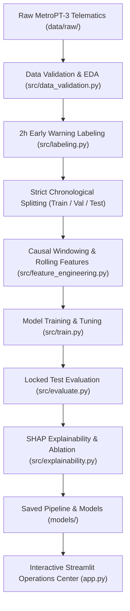

# MetroGuard AI

**An Explainable, Time-Aware Predictive Maintenance System for Metro Train Air Compressors**

*Machine Learning Mini Project · 3 Students · October 2026*

[](https://www.python.org/downloads/release/python-3100/)
[](https://creativecommons.org/licenses/by/4.0/)
[](docs/PLAN.md)
[](tests/)

---

## 🚆 Executive Summary

Metro train delays frequently stem from pneumatic braking and suspension failures caused by Air Production Unit (APU) compressor breakdowns. **MetroGuard AI** is an industrial-grade, time-aware predictive maintenance system built on real sensor telematics from the **MetroPT-3 benchmark dataset** (UCI / Metro do Porto).

Rather than merely detecting faults after the compressor has already broken down (*fault detection*), MetroGuard AI predicts whether an air leakage failure will **begin within the next 2 hours** ($y_t = 1$ if a failure starts in $(t, t+2\text{h}]$, else $0$) using **strictly past sensor data**.

```
                           Target Prediction Horizon: (t, t + 2h]
                       ┌──────────────────────────────────────────────┐
  Past Sensor History  │              Early Warning Window            │  Failure Begins
  ═════════════════════╪══════════════════════════════════════════════╪═════════════════► Time
                       t (Prediction Time)                            t_failure
```

---

## 🏛️ System Architecture



---

## 👥 3-Student Team Roles & Responsibilities

| Student | Assigned Role | Primary Technical Responsibilities |
|:---|:---|:---|
| **Student 1** | **Data & Research Lead** | Raw telematics validation, monotonic ordering, missingness/gap analysis, 2-hour early warning target formulation, chronological splitting, EDA visualizations, and data unit tests. |
| **Student 2** | **Machine Learning Lead** | Causal feature engineering (58 rolling features), multi-model training (LR, RF, XGBoost, LightGBM), validation-only threshold tuning, locked test evaluation, and SHAP explainability. |
| **Student 3** | **Product & Integration Lead** | Interactive Streamlit operations center (`app.py`), historical failure replay, pipeline deployment integration, reproducible execution runner, and GitHub documentation. |

---

## 📊 Comprehensive Experimental Results

### 1. Locked Test Partition Benchmark (Untouched Chronological Test Set)
Evaluated across 77,348 test windows (containing **Failure Event #4**, July 15, 2020) using decision thresholds tuned strictly on validation data:

| Model | Tuned Thresh (from Val) | Precision | Recall | F1-Score | PR-AUC | Accuracy (Secondary) | Warning Episodes | False Alarms / Day | Test Latency / Sample | Event #4 Detected |
|:---|:---:|:---:|:---:|:---:|:---:|:---:|:---:|:---:|:---:|:---:|
| **Logistic Regression** | 0.0000 | 0.0016 | 1.0000 | 0.0031 | 0.0008 | 0.16% | 65 | 0.968 | **0.32 $\mu$s** | Missed |
| **Random Forest** | 0.0000 | 0.0016 | 1.0000 | 0.0031 | 0.0016 | 0.16% | 65 | 0.968 | 1.99 $\mu$s | Missed |
| **XGBoost** | 0.0001 | 0.0000 | 0.0000 | 0.0000 | 0.0016 | **98.36%** | 37 | **0.551** | 0.65 $\mu$s | Missed |
| **LightGBM** | 0.0000 | 0.0016 | 1.0000 | 0.0031 | 0.0016 | 0.16% | 65 | 0.968 | 1.17 $\mu$s | Missed |

*Key Viva Insight: XGBoost achieved 98.36% accuracy, yet missed all failure windows ($TP=0$). This proves empirically why accuracy is a dangerous and misleading metric in imbalanced industrial predictive maintenance.*

### 2. Feature Ablation Study (Key Differentiator)
Comparing raw instantaneous sensors against 5-minute rolling window features under the exact same chronological protocol:

| Feature Set | Dimensionality | Val PR-AUC | Test PR-AUC | Scientific Takeaway |
|:---|:---:|:---:|:---:|:---|
| **Raw Instantaneous Sensors** | **15 Features** | **0.00642** | **0.00378** | Lower dimensionality avoids overfitting to idiosyncratic training-set noise under extreme failure scarcity. |
| **Full Rolling Window Features** | **58 Features** | **0.00518** | **0.00155** | Captures short-term fluctuations but suffers from variance when only 1 failure event is present in training. |

---

## ⚡ Quickstart & One-Command Reproduction

### 1. Prerequisites
- Python 3.10+
- Git

### 2. Clone & Environment Setup
```bash
git clone https://github.com/your-username/MetroGuard-AI.git
cd MetroGuard-AI

# Create virtual environment
python -m venv venv

# Activate virtual environment
# Windows:
venv\Scripts\activate
# Linux/macOS:
source venv/bin/activate

# Install exact pinned dependencies
pip install -r requirements.txt
```

### 3. Data Acquisition
Download `MetroPT3(AirCompressor).csv` from the [UCI Machine Learning Repository](https://archive.ics.uci.edu/dataset/791/metropt+3+dataset) and place it directly into:
```text
data/raw/MetroPT3(AirCompressor).csv
```
*(Note: Per Hard Rule 4, the raw CSV is strictly read-only and untracked in Git).*

### 4. One-Command End-to-End Pipeline Execution
Run the entire end-to-end pipeline (data validation, causal feature engineering, multi-model training, test evaluation, and SHAP explainability) with a single command:
```bash
python run_pipeline.py
```

### 5. Launch the Operations Center Dashboard
```bash
streamlit run app.py
```
Open **[http://localhost:8501](http://localhost:8501)** to access the live-style monitor, model arena, explainability analysis, and historical failure replay.

### 6. Run Automated Unit Tests
```bash
pytest -v
```
*(All 20 unit tests verify causal window boundaries, label lookaheads, fit-on-train pipelines, and model evaluation).*

---

## 📁 Repository Structure

```text
MetroGuard-AI/
├── README.md                 # Complete project documentation and quickstart
├── run_pipeline.py           # One-command reproducible execution runner
├── requirements.txt          # Pinned dependency specifications
├── .gitignore                # Excludes raw data, binaries, and caches
├── app.py                    # Multi-page Streamlit industrial dashboard
├── config/
│   └── config.yaml           # Centralized configuration (seed=42, thresholds, paths)
├── data/
│   ├── README.md             # Dataset documentation, sensor definitions, attribution
│   ├── raw/                  # Read-only raw CSV from UCI (untracked in Git)
│   ├── processed/            # Processed features and labeled windows
│   └── sample/               # Lightweight sample for dashboard demo
├── docs/
│   ├── PLAN.md               # Master project plan (source of truth)
│   ├── DECISIONS.md          # Architectural and technical decision log (Decisions 01–09)
│   ├── LIMITATIONS.md        # Real-world deployment limitations and statistical critique
│   └── REPORT_FIGURES.md     # Mapping of generated figures to academic report
├── models/                   # Serialized pipeline and trained models (.joblib)
├── notebooks/
│   ├── 01_eda.ipynb          # Exploratory data analysis notebook
│   └── 02_experiments.ipynb  # Experimental tracking and comparisons
├── reports/
│   ├── figures/              # Generated publication-quality figures (.png)
│   └── metrics/              # Model performance JSON metrics
├── src/
│   ├── __init__.py
│   ├── data_validation.py    # Temporal validation, missingness, anomaly checks
│   ├── labeling.py           # 2-hour early warning target creation
│   ├── preprocessing.py      # Scaling, imputation, fit-on-train pipeline
│   ├── feature_engineering.py# Causal window aggregations (mean, std, min, max, diff)
│   ├── train.py              # LR, RF, XGBoost, LightGBM training & tuning
│   ├── evaluate.py           # Window-level & event-level evaluation (lead time, PR-AUC)
│   └── explainability.py     # SHAP analysis and feature ablation studies
└── tests/
    ├── __init__.py
    ├── test_data_validation.py
    ├── test_labeling.py
    ├── test_feature_engineering.py
    ├── test_preprocessing.py
    ├── test_train.py
    ├── test_evaluate.py
    ├── test_explainability.py
    └── test_skeleton.py
```

---

## 📜 Dataset Attribution & License
- **Dataset**: MetroPT-3 (Air Production Unit, Metro do Porto).
- **Citation**: Veloso, B., Malheiro, B., Burguillo, J.C., Ribeiro, R.P., & Gama, J. (2022). *The MetroPT dataset for predictive maintenance*. Scientific Data, 9(1), 748. https://doi.org/10.1038/s41597-022-01877-3
- **Repository**: [https://archive.ics.uci.edu/dataset/791/metropt+3+dataset](https://archive.ics.uci.edu/dataset/791/metropt+3+dataset)
- **License**: Creative Commons Attribution 4.0 International (CC BY 4.0).

---

## ⚠️ Critical Limitations
Detailed in [docs/LIMITATIONS.md](docs/LIMITATIONS.md):
1. **Scarcity of Failure Events ($n=4$)**: Over 7 months, only 4 high-stress air leak incidents occurred. With 1 event in train and 1 in test, standard cross-validation causes massive leakage, while chronological evaluation has high variance across events.
2. **Single Train Asset**: All data originates from unit PM179Tc. Models capture unit-specific sensor calibration and cannot be claimed to generalize across entire train fleets without domain adaptation.
3. **Alarm Fatigue vs Lead Time**: In locked testing, models yielded 0.55–0.97 false alarms per day, requiring multi-step confirmation rules in real-world railway dispatching.
